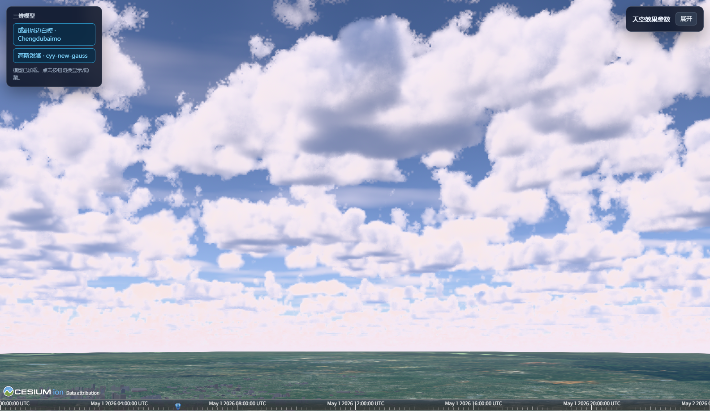
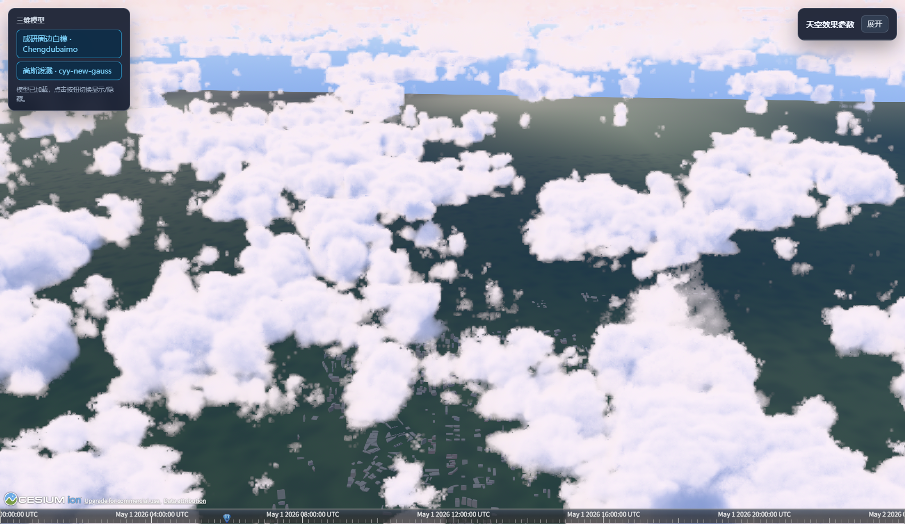
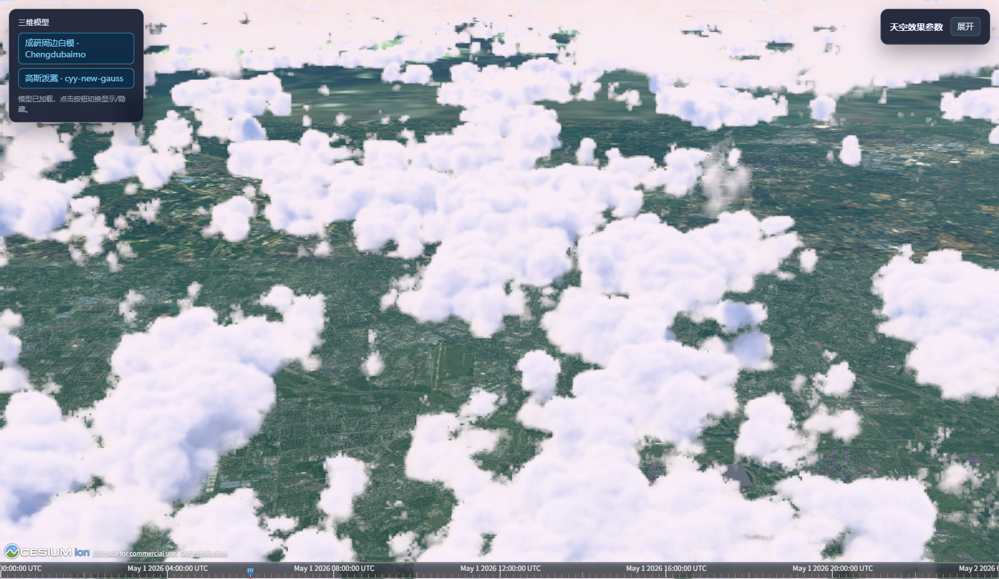
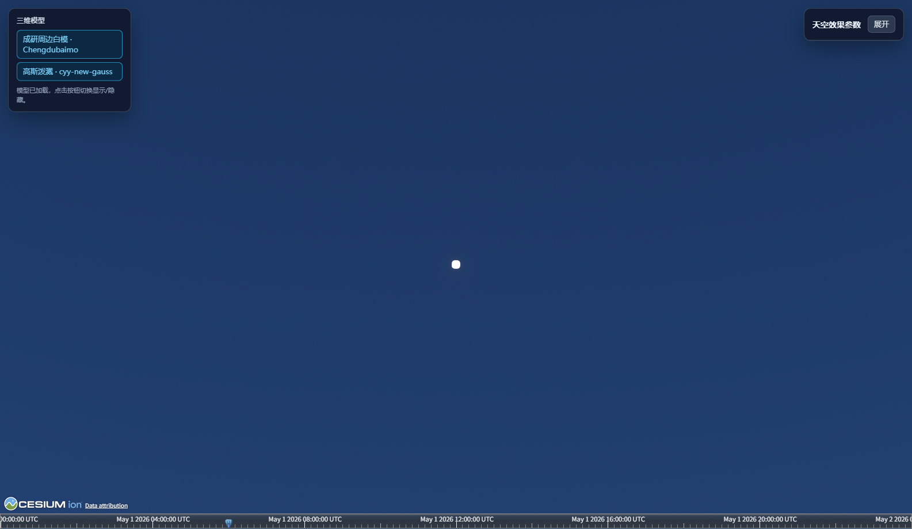

# BetterSky 1.1.0 development validation

Date: 2026-11-09. This records the development branch, not an npm release.

## Changes

The SDK now prepares required assets and GPU commands before atomically taking over native sky, Gaussian color and tone mapping. Finite projection rays fix startup HBAO NaNs. An empty captured frame no longer falls back to an older native depth attachment. Terrain depth testing defaults to `true`, with explicit `false` and `null` still supported.

Clouds and cloud shadows share density sampling. Detail erosion preserves the zero-strength identity, solar integration covers non-overlapping intervals, and cloud depth uses Beer-weighted contributions. Weather advection and camera motion participate in history validation; current Bayer samples retain their detail instead of receiving forced distant blur. The default preset favors cumulus with fewer secondary cloud cells.

HDR pre-exposure protects half-float intermediate targets. Solar lens scatter is limited independently of material exposure and follows solar visibility, preventing bright clouds or the solar disk from creating a broad white wash.

## Automated checks

- `node --experimental-vm-modules --test`: 153 passed, 0 failed.
- `pnpm run build:sdk`: passed; 100 modules, 53 shaders, 9 assets.
- `node --check` for the SDK entry and both demo scripts: passed.
- `git diff --check`: passed.

Tests cover float32 projection cancellation, depth formats and frustums, degenerate HBAO, empty-frame depth, activation and resource failure, Gaussian command isolation, density/integration equations, temporal rejection, settings restoration and resource disposal.

## Browser checks

Cesium 1.142.0, WebGL 2, ANGLE/D3D11, NVIDIA RTX 3080. Functional screenshots use the browser's native viewport; performance measurements use exactly 1920 × 1080, MSAA 1 and SDK SMAA.

- Cold-cache bypass and warm-cache startup: 10 runs each, 60 sampled frames per run. No black silhouettes after activation and no shader/runtime errors. The initial unrendered native Cesium frames can be blank while globe data is unavailable; the SDK does not conceal those frames with a loading overlay.
- Required weather-resource failure retains native sky and native Gaussian rendering. Explicit retry successfully activates effects.
- HDR on/off × logarithmic depth on/off × MSAA 1/4: all 8 combinations render without errors.
- Cloud-under, cloud-interior and cloud-over views; side/front light; programmatic translation/rotation/zoom and a real mouse drag: checked. No persistent old cloud outlines or ground trails observed after stopping. Quarter-resolution thin edges can still show sampling noise.
- Resolution 0.75 → 1, world terrain → ellipsoid → world terrain, and two dispose/recreate cycles: no render errors. Disposal leaves zero SDK stages and restores native HDR/depth settings.
- Direct solar view: all HDR aerial pixels finite; measured RGB peak 3988 with internal pre-exposure approximately 0.01946.

Raw results are provided beside this document. Frame readbacks used for startup diagnostics were excluded from performance measurements.

## Performance and limits

`performance.json` contains 60 GPU timer-query samples and 120 wall-frame intervals per representative view. P50/P95/P99 are reported separately; GPU timings are not treated as measured FPS. The native baseline uses the same resolution, MSAA 1 and SDK SMAA. It restores the host lighting when BetterSky is disabled, so its images are not a matched lighting reference.

| View | GPU P50 / P95 / P99 (ms) | Native GPU P50 (ms) | Extra GPU P50 (ms) | Wall interval P50 / P95 / P99 (ms) |
| --- | --- | --- | --- | --- |
| gaussian-near | 13.66 / 15.16 / 15.37 | 5.44 | 8.22 | 16.60 / 18.60 / 19.00 |
| ordinary-only | 6.55 / 8.28 / 8.64 | 1.31 | 5.24 | 16.60 / 18.40 / 18.80 |
| cloud-overhead | 23.06 / 27.63 / 29.77 | 1.65 | 21.41 | 21.10 / 46.50 / 49.60 |

The ordinary and Gaussian near views approach a 16.7 ms wall-frame interval. Cloud-overhead rendering does **not** meet the approximately 60 FPS goal or the extra 5 ms GPU reference budget. This remains a performance limitation; the implementation retains correct color and occlusion rather than declaring the target achieved.

New Gaussian/depth/front-medium attachments and the native shadow atlas account for approximately 125.75 MiB at 1080p. This counts allocated texture formats, excludes driver padding/deferred frees and existing host environment maps, and is not total application VRAM.

## Visual evidence

Clouds viewed from below:

Clouds viewed from above:

After a real mouse drag and settling:

Direct solar view with bounded lens scatter:

